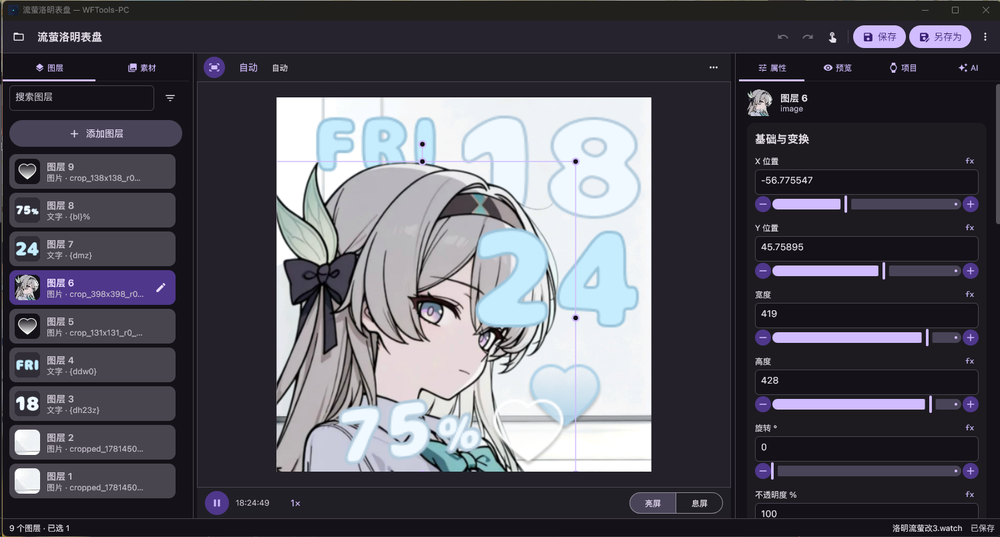
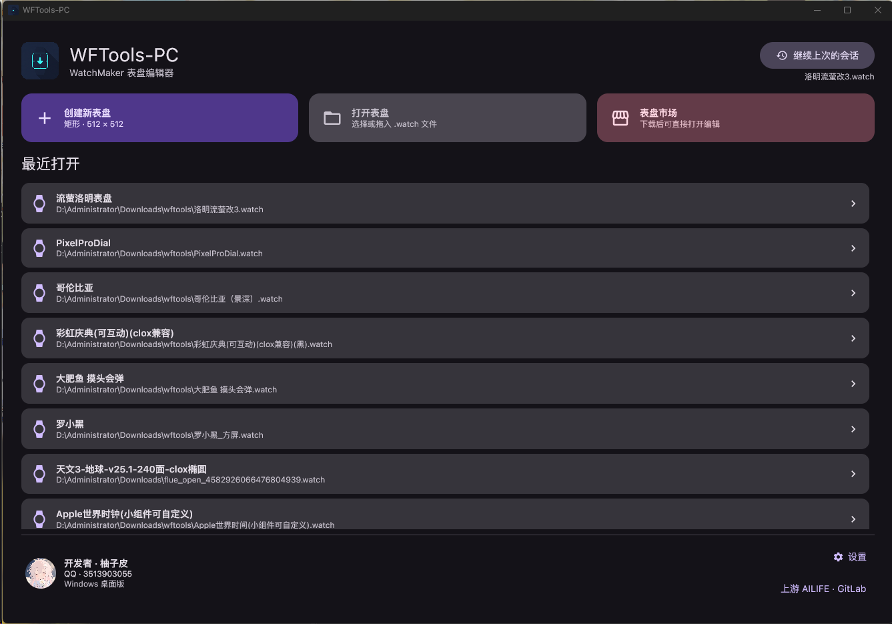
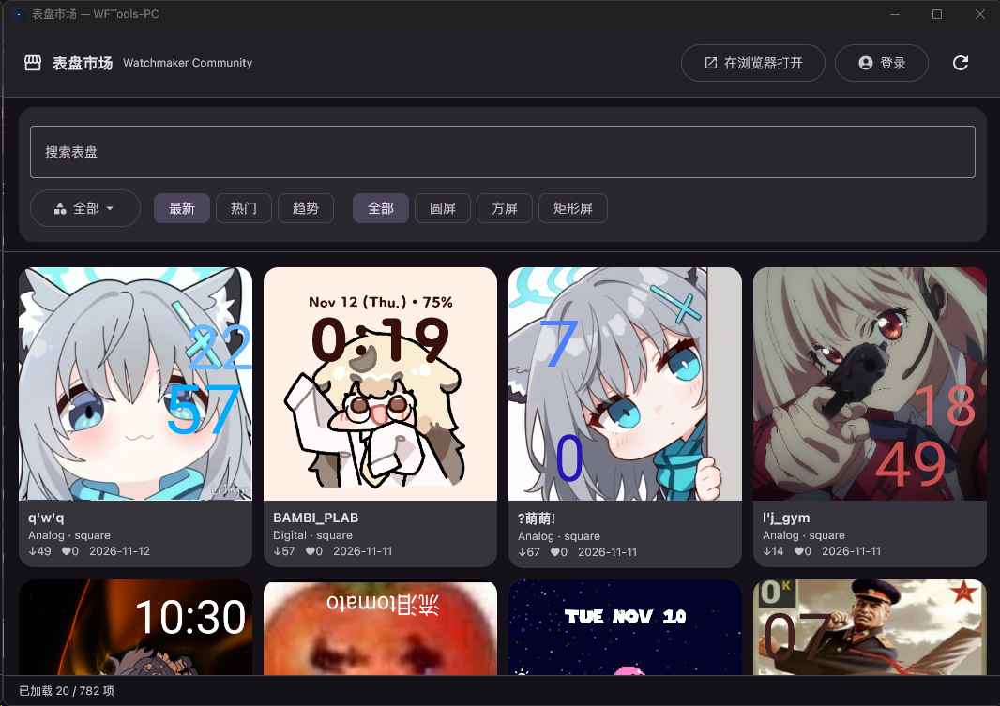

# WFTools-PC

**English** · [简体中文](README.zh-CN.md)

[](LICENSE)
[](https://github.com/xumidcm/WFTools-PC/actions/workflows/build.yml)
[](gradle/libs.versions.toml)
[](gradle/libs.versions.toml)
[](#platform-support)

A desktop editor for [WatchMaker](https://getwatchmaker.com/) `.watch` watch faces, written in Kotlin with Compose Desktop.

WFTools-PC takes the feature set of the mobile WFTools app and rebuilds it for a mouse-and-keyboard workstation: precise layer editing on a 512×512 design canvas, the full WatchMaker runtime preview (expressions, Lua, video, audio, sensors), real file-system access, and one window per watch face. The guiding constraint is **lossless round-tripping** — unknown XML, scripts, unreferenced assets and metadata are always preserved, and a failed operation must never damage your original file.

> The Android application this project was ported from is not distributed here. Its original sources are published by AILIFE at [gitlab.com/ailife8881/wftools](https://gitlab.com/ailife8881/wftools).

## Features

**Editing**
- Multi-document, multi-window: one `.watch` per window, each with its own undo/redo history (50 steps), preview state and player.
- Layer list with real rendered thumbnails, search and type filters; single, Ctrl-toggle, Shift-range and Ctrl+Shift additive selection.
- Property cards grouped by semantics (content, position, appearance) rather than a raw key dump — with the unmodified field values still reachable for forward compatibility.
- Expression-aware sliders: `fx` fields keep your original expression when you drag, and canvas moves are composed onto the existing expression instead of replacing it.
- Direct manipulation on the canvas: drag, nudge (1 / Shift 10 / Alt 0.1 design units), snapping, wheel resize, Ctrl+wheel zoom around the pointer, middle-drag or space-drag pan.
- Asset library with image, animation first-frame, video-frame and font previews. Drop an asset on the canvas to place a layer; drop it on the asset panel to only import it. Referenced assets refuse destructive removal.
- Batch import, drag-and-drop from the OS, and one undo entry per gesture or import batch.

**Preview**
- Full WatchMaker renderer: expressions, scripts, bitmaps, outlines, rotations, masks.
- Device viewport simulation (480×480, 320×386, 368×448, 410×502 or custom 64–2048) with FIT/FILL/STRETCH/zoom/offset. Simulation never changes the document or the exported data.
- Time machine, play/pause and speed control, bright/dim, theme switching, and simulated sensor values.
- Video and audio playback through libVLC.

**Saving**
- `Ctrl+S` writes back to the original file; new documents use Save As.
- Unmodified documents are never re-archived — the bytes on disk stay identical.
- Modified documents are written to a temporary archive, re-read and verified, then atomically swapped in.
- If the file changed on disk underneath you, saving asks before overwriting.
- Unsaved drafts are recoverable on the next launch.

**Extras**
- Watch face market browser (Watchmaker Community v2) in its own window, with search, paging, download and an account/creator panel.
- Built-in AI agent panel that can inspect and edit the open document through tools, with provider profiles for OpenAI-compatible Chat Completions, OpenAI Responses and Anthropic Messages APIs. Keys are stored locally and never bundled.
- Chinese and English UI (follow system, or pin one), Windows/Linux light and dark themes, 100–200 % DPI.

## Screenshots



| Home | Watch face market |
|:--:|:--:|
| [](docs/screenshots/home.png) | [](docs/screenshots/market.png) |

## Platform support

| Platform | Status | Distribution |
|---|---|---|
| Windows 10/11 x64 | Primary target | MSI installer (per-user) and portable ZIP |
| Linux x64 (glibc, Ubuntu/Debian) | Supported | `.deb` package and portable tarball |
| macOS | Not supported | — |
| WSLg | Not supported | Rendering is unreliable under WSLg; use a real X11/Wayland desktop |

On Linux the application uses your distribution's VLC/LibVLC and FFmpeg. The Windows packages ship a private Java runtime and libVLC, so nothing else needs to be installed.

## Getting started

### Download

Grab the archive for your platform from [Releases](https://github.com/xumidcm/WFTools-PC/releases), and verify it against the published `*-SHA256SUMS.txt`.

- **Windows MSI** — installs per user into `%LOCALAPPDATA%\Programs\WFTools-PC`, adds Start Menu and desktop shortcuts, and registers WFTools-PC as a *candidate* handler for `.watch` (it never hijacks your current default).
- **Windows portable ZIP** — extract the whole archive and run `WFTools-PC.exe`. Do not copy the executable alone; the `app` and `runtime` folders must stay next to it.
- **Linux `.deb`** — `sudo apt install ./WFTools-PC-<version>-linux-x64.deb` resolves VLC, LibVLC, FFmpeg and MIME dependencies.
- **Linux portable tarball** — extract, then run `./WFTools-PC-<version>-linux-x64-portable/run-wftools.sh`.

The detailed guides ship with the packages: [`packaging/README_WINDOWS.md`](packaging/README_WINDOWS.md), [`packaging/README_LINUX.md`](packaging/README_LINUX.md), and the in-app user guide [`docs/windows/USER_GUIDE.md`](docs/windows/USER_GUIDE.md).

### Build from source

Requirements: **JDK 21** (the toolchain is pinned to 21) and a network connection for the first Gradle run. Use the bundled wrapper — do not install Gradle separately.

```powershell
# Windows (native PowerShell, from the repository root)
.\gradlew.bat build                              # compile all modules
.\gradlew.bat test                               # run the JVM unit and UI tests
.\gradlew.bat :watch-core:test                   # one module only
.\gradlew.bat :desktopApp:createDistributable    # build the desktop app image
```

```bash
# Linux
./gradlew build
./gradlew test
./gradlew :desktopApp:createDistributable
```

Run the app straight from sources with `./gradlew :desktopApp:run`.

To keep build output isolated per platform or per experiment, pass the platform flag — output lands in `.build/<platform>/`:

```powershell
.\gradlew.bat -Pwftools.buildPlatform=windows test
```

Do not run two Gradle builds against the same output directory or cache at the same time.

### Package a release

Packaging is a two-step, serial process: build the application image with Compose, then post-process it into a distributable.

```powershell
.\gradlew.bat :desktopApp:createDistributable
.\scripts\package-windows.ps1 -AppImage '.\desktopApp\build\compose\binaries\main\app\WFTools-PC' -Version '0.1.6'
```

```bash
./gradlew :desktopApp:createDistributable
./scripts/package-linux.sh
```

Both scripts verify the bundled runtime, VLC provenance and licence files, compute checksums, and write everything under `artifacts/`. `package-windows.ps1 -ValidateOnly` re-checks an existing image without copying or building the MSI.

## Project layout

| Module | Responsibility |
|---|---|
| [`watch-core`](watch-core) | `.watch` XML and archive model, document sessions, lossless read/write, undo/redo, crash-safe recovery |
| [`watch-renderer`](watch-renderer) | WatchMaker runtime: expression evaluation, Lua, layer rendering, media playback, thumbnails, capture/export |
| [`agent-core`](agent-core) | AI provider profiles and HTTP clients, streaming parsers, context budgeting, tool contracts |
| [`desktopApp`](desktopApp) | Compose Desktop UI, platform integration (Windows common dialogs, file association, instance broker), i18n, packaging |
| [`scripts`](scripts) | Build, package and verification scripts |
| [`docs`](docs) | Design decisions, implementation status and the user guide |
| [`packaging`](packaging) | Icons, licence texts, third-party notices and per-platform package notes |

Dependency versions live in a single place: [`gradle/libs.versions.toml`](gradle/libs.versions.toml).

## Documentation

- [User guide](docs/windows/USER_GUIDE.md) — everyday workflows, keyboard map, preview controls.
- [Implementation status](docs/windows/IMPLEMENTATION.md) — what is verified and what is still open.
- [Mobile parity notes](docs/windows/MOBILE_PARITY.md) — how desktop behaviour maps to the Android app.
- [Product definition](PRODUCT.md) and [design contract](DESIGN.md) — the agreed scope and visual language.
- [Design specs](docs/superpowers/specs) — dated decision records for canvas input, distribution, market preview and account handling.
- [Release process](docs/RELEASING.md) — how a version is built, packaged, tagged and published.
- [Third-party notices](packaging/licenses/THIRD-PARTY-NOTICES.md) — every component shipped in a package.

## Known limitations

- Protected `watch.pxml` faces cannot be opened. Ask the face's owner to export an unprotected, editable copy from WatchMaker first.
- `gallery_2d` and layer types the upstream runtime does not implement are preserved byte-for-byte and shown as such, but are not rendered.
- The market browser talks to a third-party service; it needs network access, and the faces you download remain the property of their authors.
- Sensor values in the preview are simulated. Map layers require network access.
- The AI agent needs your own provider endpoint and API key; nothing is included.

## License

WFTools-PC is free software: you can redistribute it and/or modify it under the terms of the **GNU General Public License, version 3** as published by the Free Software Foundation. See [LICENSE](LICENSE) for the full text.

    WFTools-PC
    Copyright (C) 2026 the WFTools-PC authors

    This program is free software: you can redistribute it and/or modify
    it under the terms of the GNU General Public License as published by
    the Free Software Foundation, version 3 of the License.

    This program is distributed in the hope that it will be useful,
    but WITHOUT ANY WARRANTY; without even the implied warranty of
    MERCHANTABILITY or FITNESS FOR A PARTICULAR PURPOSE.  See the
    GNU General Public License for more details.

    You should have received a copy of the GNU General Public License
    along with this program.  If not, see <https://www.gnu.org/licenses/>.

Because the program is GPL-3.0, any distributed binary must be accompanied by the corresponding source. This repository *is* that source.

### Attribution

- The desktop port is derived from the Android version of **WFTools** developed by **AILIFE** ([gitlab.com/ailife8881/wftools](https://gitlab.com/ailife8881/wftools)).
- Rendering and preview semantics follow the **Flue** watch face runtime.
- Bundled third-party components keep their own licences: **libVLC** (GPL-2.0), **vlcj** (GPL-3.0), **Roboto** (Apache-2.0), the packaged Java runtime, and the JVM dependencies whose licence files are collected in each release. See [`packaging/licenses/THIRD-PARTY-NOTICES.md`](packaging/licenses/THIRD-PARTY-NOTICES.md).
- Watch face artwork, fonts and other art assets you edit with this tool are **not** covered by this licence.

## Contributing

Bug reports, feature requests and pull requests are welcome — please read [CONTRIBUTING.md](CONTRIBUTING.md) first. Security issues should go through [SECURITY.md](SECURITY.md), not the public issue tracker.

## Acknowledgements

Thanks to AILIFE for the original WFTools app, to the Flue project for the runtime semantics this editor follows, and to the WatchMaker community whose faces drove nearly every compatibility fix.
