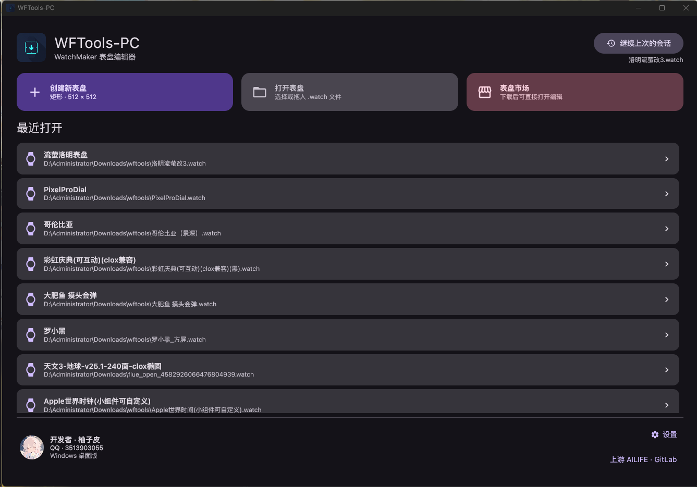
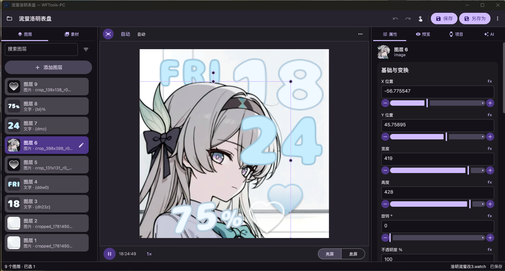
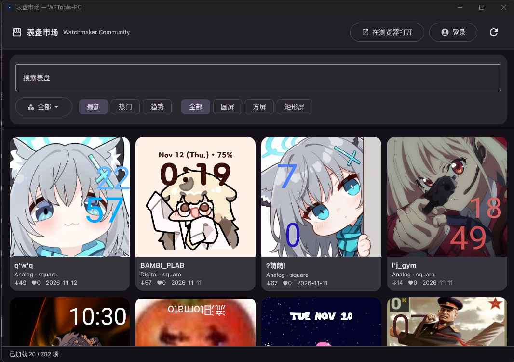

# WFTools-PC

[English](README.md) · **简体中文**

[](LICENSE)
[](https://github.com/xumidcm/WFTools-PC/actions/workflows/build.yml)
[](gradle/libs.versions.toml)
[](gradle/libs.versions.toml)
[](#平台支持)

用 Kotlin 与 Compose Desktop 编写的 [WatchMaker](https://getwatchmaker.com/) `.watch` 表盘桌面编辑器。

WFTools-PC 把手机版 WFTools 的功能搬到为键盘鼠标设计的工作站上：512×512 设计坐标系里的精确图层编辑、完整的 WatchMaker 运行时预览（表达式、Lua、视频、音频、传感器）、真正的文件系统读写，以及一个表盘一个窗口。贯穿全部设计的一条硬性约束是**无损往返**——未知 XML、脚本、未引用素材和元数据一律保留，任何失败的操作都不能损坏原文件。

> 本项目由 Android 版移植而来，原实现保留在 [`app/`](app) 作为迁移参考，不参与默认 Gradle 构建。

## 功能

**编辑**
- 多文档、多窗口：每个 `.watch` 独立窗口，各自保有撤销/重做历史（50 步）、预览状态与播放器。
- 图层面板显示真实渲染缩略图，支持搜索与类型筛选；单击选中、Ctrl 增减、Shift 连选、Ctrl+Shift 追加范围。
- 属性按语义分组（内容、位置、外观）而不是裸露的键值表，同时保留原始字段以便向前兼容。
- 表达式感知的滑杆：拖动 `fx` 数值不会把表达式静默替换成采样值，画布移动会在原表达式上合成位移增量。
- 画布直接操作：拖动、微移（1 / Shift 10 / Alt 0.1 个设计单位）、吸附、滚轮缩放图层、Ctrl+滚轮围绕指针缩放、中键或空格拖动平移。
- 素材库提供图片、动画首帧、视频帧和字体预览。拖到画布会创建图层，拖到素材面板只入库；被引用的素材拒绝破坏性删除。
- 批量导入、系统拖放，每次手势或整批导入各算一次撤销。

**预览**
- 完整 WatchMaker 渲染：表达式、脚本、位图字体、描边、旋转、遮罩。
- 设备视口模拟（480×480、320×386、368×448、410×502，或 64–2048 自定义宽高）与 FIT/FILL/拉伸/倍率/偏移。模拟只影响查看方式，不写入文档或导出数据。
- 时间机器、播放/暂停与倍速、亮屏/息屏、主题切换，以及模拟传感器数据。
- 通过 libVLC 播放视频与音频。

**保存**
- `Ctrl+S` 直接保存回原文件；新建文档走另存为。
- 未修改的文档保存时不重新打包，磁盘上的字节保持不变。
- 修改过的文档先写入临时归档、重新读取校验，再原子替换。
- 源文件被其他软件改动过时，保存前会提示，避免覆盖外部修改。
- 未保存的草稿可在下次启动时恢复。

**其它**
- 独立窗口的表盘市场浏览（Watchmaker Community v2），支持搜索、翻页、下载与账号/创作者面板。
- 内置 AI Agent 面板，可通过工具查看和修改当前文档；Provider 配置支持 OpenAI 兼容的 Chat Completions、OpenAI Responses 与 Anthropic Messages。密钥只存本地，不随程序分发。
- 中英文界面（跟随系统或手动指定）、Windows/Linux 明暗主题、100–200 % DPI 缩放。

<!-- 截图：docs/screenshots/ 下的图片就位后，删掉本注释块的开头与结尾标记即可显示。

## 截图

| 首页 | 编辑器 |
|---|---|
|  |  |

| 表盘市场 | Agent 面板 |
|---|---|
|  |  |

-->

## 平台支持

| 平台 | 状态 | 分发形式 |
|---|---|---|
| Windows 10/11 x64 | 主要目标 | MSI 安装包（按用户安装）与便携 ZIP |
| Linux x64（glibc，Ubuntu/Debian） | 支持 | `.deb` 安装包与便携 tar 包 |
| macOS | 不支持 | — |
| WSLg | 不支持 | WSLg 下渲染不可靠，请使用真实 X11/Wayland 桌面 |

Linux 版使用发行版提供的 VLC/LibVLC 与 FFmpeg；Windows 版自带 Java 运行时和 libVLC，无需另行安装。

## 快速开始

### 下载

从 [Releases](https://github.com/xumidcm/WFTools-PC/releases) 下载对应平台的压缩包，并用同目录的 `*-SHA256SUMS.txt` 校验。

- **Windows MSI**：按当前用户安装到 `%LOCALAPPDATA%\Programs\WFTools-PC`，创建开始菜单与桌面快捷方式，并把 WFTools-PC 注册为 `.watch` 的*候选*打开方式（不会抢占现有默认程序）。
- **Windows 便携 ZIP**：完整解压后双击 `WFTools-PC.exe`。不要只复制 EXE，`app` 与 `runtime` 目录必须保留在旁边。
- **Linux `.deb`**：`sudo apt install ./WFTools-PC-<版本>-linux-x64.deb` 会一并补齐 VLC、LibVLC、FFmpeg 与 MIME 依赖。
- **Linux 便携包**：解压后运行 `./WFTools-PC-<版本>-linux-x64-portable/run-wftools.sh`。

随包文档：[`packaging/README_WINDOWS.md`](packaging/README_WINDOWS.md)、[`packaging/README_LINUX.md`](packaging/README_LINUX.md)，以及应用内使用说明 [`docs/windows/USER_GUIDE.md`](docs/windows/USER_GUIDE.md)。

### 从源码构建

需要 **JDK 21**（工具链固定为 21），首次运行 Gradle 需要联网。请使用仓库自带的 wrapper，不要单独安装 Gradle。

```powershell
# Windows（原生 PowerShell，在仓库根目录执行）
.\gradlew.bat build                              # 编译全部模块
.\gradlew.bat test                               # 运行 JVM 单元与 UI 测试
.\gradlew.bat :watch-core:test                   # 只测一个模块
.\gradlew.bat :desktopApp:createDistributable    # 生成桌面应用镜像
```

```bash
# Linux
./gradlew build
./gradlew test
./gradlew :desktopApp:createDistributable
```

想直接从源码运行，用 `./gradlew :desktopApp:run`。

需要隔离不同平台或不同实验的产物时，加上平台标记，输出会落到 `.build/<platform>/`：

```powershell
.\gradlew.bat -Pwftools.buildPlatform=windows test
```

不要对同一个输出目录或缓存并发执行 Gradle 构建。

### 打包发布

打包是串行的两步：先用 Compose 生成应用镜像，再交给脚本产出分发包。

```powershell
.\gradlew.bat :desktopApp:createDistributable
.\scripts\package-windows.ps1 -AppImage '.\desktopApp\build\compose\binaries\main\app\WFTools-PC' -Version '0.1.6'
```

```bash
./gradlew :desktopApp:createDistributable
./scripts/package-linux.sh
```

两个脚本都会校验随包运行时、VLC 来源与许可证文件，计算校验和，并把产物写到 `artifacts/`。`package-windows.ps1 -ValidateOnly` 可在不复制、不编译 MSI 的前提下复查已有镜像。

## 项目结构

| 模块 | 职责 |
|---|---|
| [`watch-core`](watch-core) | `.watch` XML 与归档模型、文档会话、无损读写、撤销/重做、崩溃安全恢复 |
| [`watch-renderer`](watch-renderer) | WatchMaker 运行时：表达式求值、Lua、图层渲染、媒体播放、缩略图、捕获与导出 |
| [`agent-core`](agent-core) | AI Provider 配置与 HTTP 客户端、流式解析、上下文预算、工具契约 |
| [`desktopApp`](desktopApp) | Compose Desktop 界面、平台集成（Windows 通用对话框、文件关联、单实例路由）、国际化、打包 |
| [`app`](app) | 上游 Android 实现，仅作参考，**不**参与默认构建 |
| [`scripts`](scripts) | 构建、打包与验证脚本 |
| [`docs`](docs) | 设计决策、实施状态与使用说明 |
| [`packaging`](packaging) | 图标、许可证文本、第三方声明与各平台打包说明 |

依赖版本只有一处来源：[`gradle/libs.versions.toml`](gradle/libs.versions.toml)。

## 文档

- [使用说明](docs/windows/USER_GUIDE.md)：日常操作、快捷键、预览控制。
- [实施状态](docs/windows/IMPLEMENTATION.md)：已验证的内容与仍未完成的部分。
- [手机版对齐说明](docs/windows/MOBILE_PARITY.md)：桌面行为与手机版的对应关系。
- [产品定义](PRODUCT.md) 与 [设计契约](DESIGN.md)：已确认的范围与视觉语言。
- [设计规格](docs/superpowers/specs)：画布输入、分发、市场预览与账号处理的带日期决策记录。
- [第三方声明](packaging/licenses/THIRD-PARTY-NOTICES.md)：随包分发的每一个组件。

## 已知限制

- 受保护的 `watch.pxml` 表盘无法打开，需要文件所有者在 WatchMaker 中先导出未保护的可编辑版本。
- `gallery_2d` 以及上游运行时未实现的图层类型会按原字节保留并标注，但不会渲染。
- 市场浏览依赖第三方服务，需要联网；下载到的表盘版权仍归其作者所有。
- 预览中的传感器数值为模拟值，地图图层需要联网。
- AI Agent 需要自备 Provider 地址与 API Key，程序不内置任何密钥。

## 许可证

WFTools-PC 是自由软件：你可以依据自由软件基金会发布的 **GNU 通用公共许可证第 3 版** 条款重新分发和/或修改它。完整文本见 [LICENSE](LICENSE)。

```
WFTools-PC
Copyright (C) 2026 the WFTools-PC authors

本程序是自由软件：你可以根据自由软件基金会发布的 GNU 通用公共许可证
第 3 版的条款重新分发和/或修改它。

本程序的发布是希望它有用，但不提供任何担保，甚至不包含适销性或
特定用途适用性的默示担保。详情请参阅 GNU 通用公共许可证。

你应当已随本程序收到 GNU 通用公共许可证的副本。
如果没有，请见 <https://www.gnu.org/licenses/>。
```

由于采用 GPL-3.0，分发二进制时必须同时提供对应源码——本仓库就是该源码。

### 署名与来源

- 桌面版移植自 **AILIFE** 开发的 Android 版 **WFTools**（[gitlab.com/ailife8881/wftools](https://gitlab.com/ailife8881/wftools)）。
- 渲染与预览语义参照 **Flue** 表盘运行时。
- 随包的第三方组件各自保留原有许可证：**libVLC**（GPL-2.0）、**vlcj**（GPL-3.0）、**Roboto**（Apache-2.0）、打包的 Java 运行时，以及每个发行版中收集了许可证文件的各项 JVM 依赖。详见 [`packaging/licenses/THIRD-PARTY-NOTICES.md`](packaging/licenses/THIRD-PARTY-NOTICES.md)。
- 你用本工具编辑的表盘素材、字体与其它美术资源**不**在本许可证覆盖范围内。

## 参与贡献

欢迎提交问题、功能建议和 Pull Request，请先阅读 [CONTRIBUTING.md](CONTRIBUTING.md)。安全问题请按 [SECURITY.md](SECURITY.md) 私下报告，不要开公开 issue。

## 致谢

感谢 AILIFE 提供的原始 WFTools 应用，感谢 Flue 项目定义的表盘运行时语义，也感谢 WatchMaker 社区——几乎每一次兼容性修复都由社区表盘促成。
